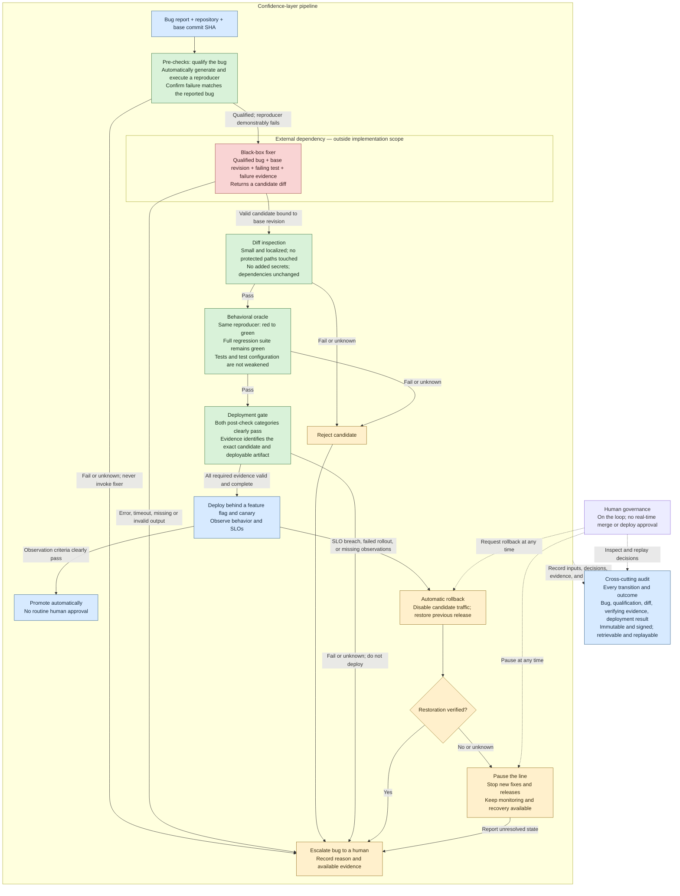

# Confidence layer: flow for review

Status: shared understanding for review, before grill-me and Wayfinder. This captures the agreed pipeline and the suggested failure paths; it does not select implementation tools or authorize implementation.

Source: [SAP challenge brief](<SAP - AI Hackathon with Nebius & NVIDIA.pdf>), especially pages 1–2, and the team's diagram discussed in this chat.

## How to read this flow

- **Fail closed:** a failed, missing, inconclusive, or timed-out check never counts as a pass. Before deployment, reject or escalate without shipping. After possible traffic exposure, recover the previous release and verify the result.
- **Qualification is provisional:** pre-checks establish an eligible bug and a genuine reproducible failure. The actual patch's size and locality can only be enforced after the fixer returns it. An unrelated test failure or broken environment does not qualify a bug.
- **Both post-check categories are mandatory:** diff inspection and behavioral verification cannot compensate for each other. Their sequential arrangement here is illustrative, not a scheduling requirement.
- **Evidence stays bound to its subject:** distinguish the base commit, candidate diff/revision, reproducer, test execution, and deployed artifact. The deployed artifact must be the one verification authorized. The fixer cannot weaken the tests, test command, or gate policy to manufacture success.
- **The fixer stays external:** neither its internals nor its runtime hosting/containment belongs to this implementation. Executing verification tests is part of the confidence layer.
- **Audit covers failures too:** the audit connection represents every transition, including refusal, rejection, escalation, promotion, rollback, and human intervention. Signatures establish authenticity and integrity; immutable retention is a separate property to implement and verify.
- **Audit failure cannot authorize release:** missing required audit evidence prevents deployment or promotion. If evidence cannot be recorded during exposure, roll back; recovery must remain possible even when the audit writer is unavailable. Report any recording gap explicitly.
- **Human intervention is an override:** pause stops new fixer and release actions; it does not stop monitoring or recovery. A human-requested rollback still requires verification. Routine successful runs need no human approval.
- **Escalation is an outcome, not an automatic approval request:** the unattended run stops. Human investigation or a later attempt is outside the successful path shown here.

## Required demonstration coverage

The brief calls for a handful of seeded trivial bugs completing the full path unattended, followed by a genuinely difficult bug being refused and escalated. Review should also exercise a rejected candidate, missing evidence, canary rollback, and audit verification. These additional failure exercises validate the interlocks; they are not a claimed judging rubric.

## Decisions still open

- Intended repair target: Express framework code or a seeded application using this repository.
- Eligible bug classes and the trusted source of expected behavior for generated tests.
- Executable definitions of small/localized, protected paths, secret inspection, and dependency changes.
- Fixer interface, available external provider, and failure/time limits.
- Deployment target, feature-flag mechanism, canary exposure, observation window, SLO thresholds, and rollback verification.
- Evidence formats, signing-key custody, immutable storage, and replay procedure.
- Which integrations can be demonstrated live, which use fixtures or simulations, and which brief requirements would remain unmet.

No numerical thresholds, sponsor technologies, specific bug fixtures, or infrastructure choices are agreed by this diagram.
